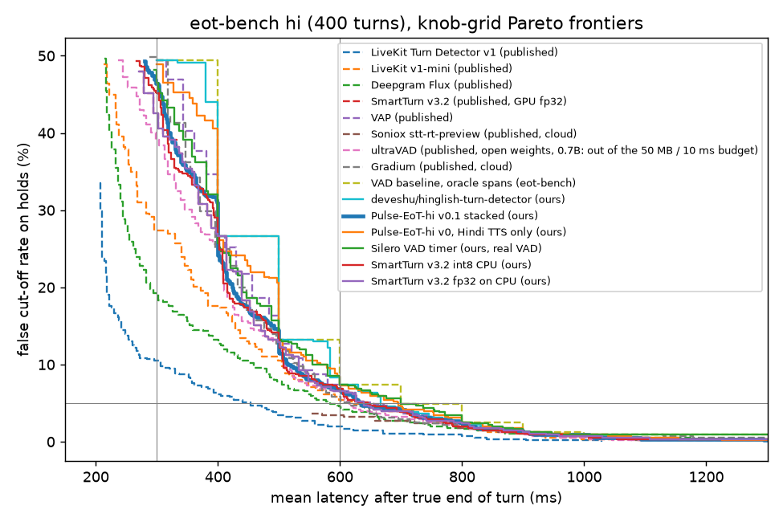

# Results (generated by `python -m eval.report`)

## eot-bench `hi` (all 400 turns, 16 kHz), eot-bench knob sweep: historical

These 400 turns informed one design iteration (v0 to v0.1) and every variant below was scored on them. Since 2026-10-20 iteration uses the 200-turn dev-test half only and the other 200 are sealed (eval/split.py). Lat@5% and FCR@300 are best-on-test operating points by eot-bench's definition; only dev-frozen knobs are deployable.

Rows marked *published* are recomputed by our metrics code from LiveKit's committed prediction files (identical to their report). Rows marked *ours* were run in this repo through the streaming harness on CPU.

| System | FCR@300 | FCR@600 | Lat@5% | Lat@10% | Detect@5% | AUC |
|---|---|---|---|---|---|---|
| LiveKit Turn Detector v1 (published) | 10.5% | 2.0% | 454 ms | 306 ms | 68.2% | 0.944 |
| Soniox stt-rt-preview (published, cloud) | - | 3.4% | 553 ms | 553 ms | 70.5% | 0.840 |
| Deepgram Flux (published) | 19.2% | 4.5% | 583 ms | 459 ms | 87.5% | 0.950 |
| ultraVAD (published, open weights, 0.7B: out of the 50 MB / 10 ms budget) | 39.1% | 6.5% | 616 ms | 509 ms | 98.2% | 0.770 |
| Gradium (published, cloud) | 49.5% | 5.8% | 618 ms | 530 ms | 91.2% | 0.887 |
| LiveKit v1-mini (published) | 27.4% | 5.4% | 624 ms | 505 ms | 75.2% | 0.842 |
| Pulse-EoT-hi v0.1 stacked (ours) | 46.4% | 6.7% | 634 ms | 514 ms | 93.5% | 0.797 |
| SmartTurn v3.2 (published, GPU fp32) | 42.6% | 6.5% | 639 ms | 532 ms | 90.2% | 0.719 |
| SmartTurn v3.2 fp32 on CPU (ours) | 42.6% | 6.5% | 639 ms | 532 ms | 90.2% | 0.719 |
| Pulse-EoT-hi v0.1 [smart_turn_only] | 49.5% | 6.3% | 642 ms | 541 ms | 92.2% | 0.823 |
| SmartTurn v3.2 int8 CPU (ours) | 45.1% | 6.9% | 646 ms | 507 ms | 88.5% | 0.731 |
| Pulse-EoT-hi v0.1 [stacked_audio_only] | 40.8% | 6.7% | 647 ms | 516 ms | 76.8% | 0.835 |
| VAP (published) | 49.5% | 7.4% | 655 ms | 539 ms | 80.5% | 0.920 |
| deveshu/hinglish-turn-detector (ours) | 49.5% | 7.4% | 667 ms | 584 ms | 83.2% | 0.672 |
| Pulse-EoT-hi v0 [no_VERB] | 48.7% | 7.4% | 680 ms | 553 ms | 81.5% | 0.639 |
| Pulse-EoT-hi v0 [no_TAG] | 48.6% | 7.2% | 690 ms | 566 ms | 78.5% | 0.645 |
| Pulse-EoT-hi v0 [no_HOLD] | 49.1% | 7.2% | 692 ms | 554 ms | 77.8% | 0.642 |
| Pulse-EoT-hi v0 [no_DIGIT] | 48.4% | 7.2% | 695 ms | 578 ms | 77.2% | 0.644 |
| Pulse-EoT-hi v0, Hindi TTS only (ours) | 48.9% | 7.2% | 696 ms | 568 ms | 77.0% | 0.642 |
| Pulse-EoT-hi v0 [no_lexhead] | 49.5% | 7.4% | 697 ms | 578 ms | 76.5% | 0.648 |
| Pulse-EoT-hi v0 [audio_only] | 49.5% | 7.4% | 697 ms | 564 ms | 80.5% | 0.765 |
| VAD baseline, oracle spans (eot-bench) | 49.5% | 7.4% | 700 ms | 600 ms | 100.0% | - |
| Silero VAD timer (ours, real VAD) | 46.6% | 7.4% | 700 ms | 554 ms | 100.0% | 0.946 |



## eot-bench `hi`, channel condition `mulaw8k` (evaluation-only stress slice)

| System | FCR@300 | FCR@600 | Lat@5% | Lat@10% | Detect@5% | AUC |
|---|---|---|---|---|---|---|
| Pulse-EoT-hi v0.1 stacked (ours) | 44.7% | 5.8% | 629 ms | 523 ms | 95.0% | 0.812 |
| SmartTurn v3.2 int8 CPU (ours) | 46.9% | 6.3% | 642 ms | 525 ms | 89.5% | 0.716 |
| Silero VAD timer (ours, real VAD) | 46.7% | 7.4% | 700 ms | 566 ms | 100.0% | 0.944 |

## eot-bench `hi`, channel condition `snr10` (evaluation-only stress slice)

| System | FCR@300 | FCR@600 | Lat@5% | Lat@10% | Detect@5% | AUC |
|---|---|---|---|---|---|---|
| SmartTurn v3.2 int8 CPU (ours) | 46.0% | 6.5% | 632 ms | 516 ms | 92.0% | 0.712 |
| Pulse-EoT-hi v0.1 stacked (ours) | 48.9% | 7.4% | 674 ms | 527 ms | 83.8% | 0.800 |
| Silero VAD timer (ours, real VAD) | 46.6% | 7.4% | 700 ms | 593 ms | 100.0% | 0.940 |

## eot-bench `hi`, channel condition `snr5` (evaluation-only stress slice)

| System | FCR@300 | FCR@600 | Lat@5% | Lat@10% | Detect@5% | AUC |
|---|---|---|---|---|---|---|
| SmartTurn v3.2 int8 CPU (ours) | 46.4% | 6.9% | 640 ms | 511 ms | 90.0% | 0.707 |
| Pulse-EoT-hi v0.1 stacked (ours) | 49.5% | 7.4% | 661 ms | 551 ms | 88.2% | 0.797 |
| Silero VAD timer (ours, real VAD) | 50.7% | 9.6% | 702 ms | 594 ms | 99.8% | 0.932 |

## Hold slices, eot-bench `hi` dev-test half (200 turns)

Every system at its own Lat@5% knobs and at its own best knobs within a 600 ms mean-latency budget, chosen on the same 200 turns. Brackets: 95% Wilson interval. The slices are small, so most differences are inside the intervals.

| System | operating point (th, delay, timeout) | all holds | filler/connective holds | digit holds |
|---|---|---|---|---|
| deveshu/hinglish-turn-detector (ours) | own Lat@5%: 0.03, 0.5, 1.0 | 4.8% [2.8%, 8.3%] (n=248) | 0.0% [0.0%, 16.1%] (n=20) | 3.1% [0.6%, 15.7%] (n=32) |
| deveshu/hinglish-turn-detector (ours) | own best at <= 600 ms: 0.00, 0.6, 1.0 | 6.5% [4.0%, 10.2%] (n=248) | 5.0% [0.9%, 23.6%] (n=20) | 3.1% [0.6%, 15.7%] (n=32) |
| Pulse-EoT-hi v0.1 stacked (ours) | own Lat@5%: 0.18, 0.6, 1.5 | 4.8% [2.8%, 8.3%] (n=248) | 0.0% [0.0%, 16.1%] (n=20) | 3.1% [0.6%, 15.7%] (n=32) |
| Pulse-EoT-hi v0.1 stacked (ours) | own best at <= 600 ms: 0.63, 0.5, 1.0 | 5.2% [3.1%, 8.8%] (n=248) | 0.0% [0.0%, 16.1%] (n=20) | 3.1% [0.6%, 15.7%] (n=32) |
| Pulse-EoT-hi v0, Hindi TTS only (ours) | own Lat@5%: 0.08, 0.6, 1.0 | 4.8% [2.8%, 8.3%] (n=248) | 0.0% [0.0%, 16.1%] (n=20) | 3.1% [0.6%, 15.7%] (n=32) |
| Pulse-EoT-hi v0, Hindi TTS only (ours) | own best at <= 600 ms: 0.01, 0.6, 1.0 | 6.0% [3.7%, 9.7%] (n=248) | 0.0% [0.0%, 16.1%] (n=20) | 3.1% [0.6%, 15.7%] (n=32) |
| Silero VAD timer (ours, real VAD) | own Lat@5%: 0.35, 0.2, 1.0 | 4.8% [2.8%, 8.3%] (n=248) | 5.0% [0.9%, 23.6%] (n=20) | 3.1% [0.6%, 15.7%] (n=32) |
| Silero VAD timer (ours, real VAD) | own best at <= 600 ms: 0.10, 0.6, 1.0 | 6.5% [4.0%, 10.2%] (n=248) | 5.0% [0.9%, 23.6%] (n=20) | 3.1% [0.6%, 15.7%] (n=32) |
| SmartTurn v3.2 int8 CPU (ours) | own Lat@5%: 0.77, 0.5, 1.0 | 4.8% [2.8%, 8.3%] (n=248) | 0.0% [0.0%, 16.1%] (n=20) | 3.1% [0.6%, 15.7%] (n=32) |
| SmartTurn v3.2 int8 CPU (ours) | own best at <= 600 ms: 0.70, 0.5, 1.0 | 5.2% [3.1%, 8.8%] (n=248) | 0.0% [0.0%, 16.1%] (n=20) | 3.1% [0.6%, 15.7%] (n=32) |
| SmartTurn v3.2 fp32 on CPU (ours) | own Lat@5%: 0.02, 0.6, 1.0 | 4.4% [2.5%, 7.8%] (n=248) | 0.0% [0.0%, 16.1%] (n=20) | 3.1% [0.6%, 15.7%] (n=32) |
| SmartTurn v3.2 fp32 on CPU (ours) | own best at <= 600 ms: 0.11, 0.5, 1.0 | 5.2% [3.1%, 8.8%] (n=248) | 0.0% [0.0%, 16.1%] (n=20) | 3.1% [0.6%, 15.7%] (n=32) |

## Deployed (VAD-timed) policy on eot-bench `hi`

| system                                                        |   threshold |   action_delay |   timeout |   fcr |   mean_latency |   p90_latency |   speech_cutins_per_turn |
|:--------------------------------------------------------------|------------:|---------------:|----------:|------:|---------------:|--------------:|-------------------------:|
| silence timer 300 ms                                          |      -1.000 |          0.300 |   inf     | 0.493 |          0.279 |         0.300 |                    0.140 |
| silence timer 400 ms                                          |      -1.000 |          0.400 |   inf     | 0.275 |          0.379 |         0.400 |                    0.142 |
| silence timer 500 ms                                          |      -1.000 |          0.500 |   inf     | 0.136 |          0.479 |         0.500 |                    0.160 |
| silence timer 600 ms                                          |      -1.000 |          0.600 |   inf     | 0.069 |          0.579 |         0.600 |                    0.115 |
| silence timer 700 ms                                          |      -1.000 |          0.700 |   inf     | 0.047 |          0.679 |         0.700 |                    0.048 |
| silence timer 800 ms                                          |      -1.000 |          0.800 |   inf     | 0.029 |          0.779 |         0.800 |                    0.020 |
| silence timer 900 ms                                          |      -1.000 |          0.900 |   inf     | 0.014 |          0.879 |         0.900 |                    0.018 |
| silence timer 1000 ms                                         |      -1.000 |          1.000 |   inf     | 0.009 |          0.979 |         1.000 |                    0.018 |
| silence timer 1100 ms                                         |      -1.000 |          1.100 |   inf     | 0.009 |          1.079 |         1.100 |                    0.005 |
| silence timer 1200 ms                                         |      -1.000 |          1.200 |   inf     | 0.007 |          1.179 |         1.200 |                    0.000 |
| Pulse-EoT-hi v0.1, dev-frozen knobs                           |       0.850 |          0.400 |     3.500 | 0.103 |          1.107 |         3.500 |                    0.043 |
| Pulse-EoT-hi v0.1, test Lat@5% knobs (oracle, reference only) |       0.410 |          0.600 |     1.000 | 0.047 |          0.625 |         0.810 |                    0.065 |

## Speech-onset vs noise classifier on TTS clips (the arbiter prototype; NOT a barge-in result)

Trained and tested on single-speaker Chirp3 TTS Hindi clips plus MUSAN noise (arbiter/data.py). Test set: {'barge_in': 1464, 'noise': 134, 'backchannel': 15}. Backchannel recall 2/15. "barge-in" is any IPU longer than 1.2 s and the model has no lexical input, so it cannot separate "haan" from "nahi ruko". Decisions happen only at 300 or 600 ms by construction. No summary score is reported because the class mix (91% barge-in) makes it meaningless.

Confusion (rows true, columns predicted):

|             |   backchannel |   barge_in |   noise |
|:------------|--------------:|-----------:|--------:|
| backchannel |             2 |         13 |       0 |
| barge_in    |             2 |       1459 |       3 |
| noise       |             2 |         14 |     118 |

- Efficiency `pulse_eot_hi` (x86 Python emulated on ARMv8 (64-bit) Family 8 Model 2 Revision 201, Qualcomm Technologies Inc): mean/p50/p95/p99 13.44/2.22/8.02/401.31 ms per hop (1 thread), 7 calls per core, model 10.6 MB, process RSS 622 MB plus 113 MB for 50 call states
- Efficiency `pulse_eot_hi:full` (x86 Python emulated on ARMv8 (64-bit) Family 8 Model 2 Revision 201, Qualcomm Technologies Inc): mean/p50/p95/p99 2.29/2.02/3.53/7.88 ms per hop (1 thread), 44 calls per core, model 2.3 MB, process RSS 660 MB plus 111 MB for 50 call states

Failure gallery: [failures.md](failures.md)

## eot-bench `hi` dev-test half (200 turns), rescored from saved predictions

Generated by `python -m eval.rescore_devtest`. Same metric code and knob grid as eot-bench. The sealed 200-turn half is not scored here (eval/split.py).

| System | FCR@300 | FCR@600 | Lat@5% | Lat@10% | n holds / EoTs |
|---|---|---|---|---|---|
| LiveKit Turn Detector v1 (published) | 8.5% | 1.2% | 384 ms | 284 ms | 248 / 200 |
| LiveKit v1-mini (published) | 24.6% | 4.8% | 550 ms | 469 ms | 248 / 200 |
| Deepgram Flux (published) | 18.5% | 3.6% | 552 ms | 431 ms | 248 / 200 |
| Soniox stt-rt-preview (published, cloud) | - | 2.8% | 554 ms | 554 ms | 248 / 200 |
| ultraVAD (published, open weights, 0.7B: out of the 50 MB / 10 ms budget) | 39.9% | 4.8% | 600 ms | 496 ms | 248 / 200 |
| VAP (published) | 50.8% | 5.2% | 601 ms | 520 ms | 248 / 200 |
| SmartTurn v3.2 int8 CPU (ours) | 37.1% | 5.2% | 602 ms | 507 ms | 248 / 200 |
| Gradium (published, cloud) | 48.8% | 5.6% | 604 ms | 541 ms | 248 / 200 |
| Pulse-EoT-hi v0.1 stacked (ours) | 43.5% | 5.2% | 611 ms | 500 ms | 248 / 200 |
| deveshu/hinglish-turn-detector (ours) | 50.8% | 6.5% | 612 ms | 535 ms | 248 / 200 |
| SmartTurn v3.2 (published, GPU fp32) | 37.1% | 5.2% | 624 ms | 481 ms | 248 / 200 |
| SmartTurn v3.2 fp32 on CPU (ours) | 37.1% | 5.2% | 624 ms | 481 ms | 248 / 200 |
| Pulse-EoT-hi v0, Hindi TTS only (ours) | 49.6% | 6.0% | 647 ms | 510 ms | 248 / 200 |
| Silero VAD timer (ours, real VAD) | 48.4% | 6.5% | 741 ms | 563 ms | 248 / 200 |

Deployable rows (knobs frozen on the dev clips, never chosen on eot-bench):

- Pulse-EoT-hi v0.1 stacked (ours): FCR 5.6% at mean latency 1156 ms (th 0.85, delay 0.4 s, timeout 3.5 s)
- Pulse-EoT-hi v0, Hindi TTS only (ours): FCR 3.2% at mean latency 2388 ms (th 0.82, delay 0.4 s, timeout 3.5 s)

Paired bootstrap over 200 dev-test turns (1000 resamples), v0.1 minus Smart Turn v3.2 fp32, each at its own Lat@5% knobs: latency -12.5 ms (95% CI -30.0 to +6.5), FCR +0.40 pp (95% CI -1.38 to +2.12).


## Points matrix (only rows measurable without Bharat-Turn-8k)

```
{
 "row1_lat5_eotbench_hi (20)": 5.26,
 "row2_fcr300_eotbench_hi (10)": 0.79
}
```
